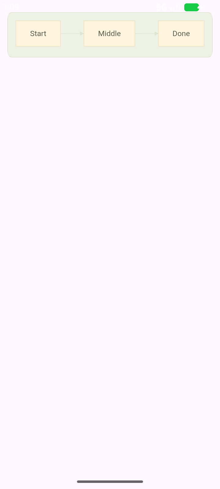

# 聊天跟底、搜索入口和完整 Markdown

对应 issue：#212、#213、#214。

## 滚动行为

打开会话默认显示最新消息。`ScrollAnchor.followLatest` 默认 `true`，旧版没有这个字段的锚点也按最新消息打开；用户主动上翻后保存 `false`，重新打开按消息 key 和偏移恢复历史位置。退出聊天时立即保存，避免快速切换会话丢掉历史浏览状态。

恢复历史位置要等当前会话的真实缓存或 API 历史页已确认加载。尚未确认历史页时，即使因为刷新或请求失败提前清除了 loading 标记，也不能消耗原来的锚点；成功返回空历史也算加载完成。这样不会先把历史锚点恢复到一条临时消息，再用这个临时位置覆盖保存值。

`FollowLatestEffect` 观察实际列表布局，而非仅观察消息数或正文长度。绘制行数包括日期、未读分隔、可选审批错误和固定 `chat-tail`。因此同一条回复增高、WebView 完成测量、键盘改变视口后，都能继续露出真正的底部。真实拖动暂停跟随，惯性停止且已经到底时恢复；点击链接不会切换跟随模式。搜索期间暂停跟随，关闭搜索后恢复原先的位置和模式。

浮动日期的滚动订阅放在单独的组合函数中。日期映射、绘制行和消息映射缓存；重内容只订阅气泡是否可见，不再直接订阅每次布局变化。UI 回归检查跨行和跨日期滚动不会重组父聊天。这证明消除了该重组来源，不代表真机帧率测量。

## 搜索和 Markdown

搜索入口在右上角三点菜单中；输入、上一条、下一条和关闭保留。

搜索直接投影聊天实际绘制的行：普通消息和折叠的工具/思考过程都使用真实行 key，重复消息 ID 不会串行，外显的思考正文不会再在折叠行重复计数。上一条、下一条和高亮共用同一个 key；搜索加载更早历史后仍保留选中行，关闭时按原行 key 恢复位置。

正文和链接读取完整历史内容，展示仍保留 32,000 字符上限。工具参数、工具输出同样参与搜索；命中摘要显示关键词附近的上下文。匹配在后台执行，仅对输入关键词延迟 150 毫秒，持续流式更新不会重置这段等待。

有命中仍继续顺序读取更早历史，直到扫完。失败、服务端仍返回截断正文或分页起点没有前进时停止，保留已找到的结果并显示重试。退出搜索、改词或切换会话会取消扫描；已经在途的共享历史请求仍由正常历史流程处理，旧搜索不会再派下一页或覆盖新搜索状态。旧的截断缓存会重新请求全文。

整条气泡正文一次传给 `MarkdownText`，空行由 Markdown 解析器处理。代码围栏、Mermaid、HTML 和公式不会被气泡动画拆开。流式气泡使用 `animateContentSize` 按自然内容尺寸增高，移除“动画约束后的高度再次成为目标高度”的反馈路径。自动跟底不会禁用该动画，用户翻看历史时暂停动画。Mermaid 原有 3 秒超时和失败回源码逻辑不变。

## 验证

```bash
./gradlew :app:testDebugUnitTest --offline
./gradlew :app:assembleDebugAndroidTest --offline -PisolatedUiTest=true
./gradlew :app:connectedDebugAndroidTest --offline -PisolatedUiTest=true \
  -Pandroid.testInstrumentationRunnerArguments.timeout_msec=60000
./gradlew :app:assembleDebug --offline
```

UI 测试使用独立包，不清理日常 debug 应用。Mermaid 验证使用原生 `ActivityScenario` 托管真实 `BubbleRow`，从实际 WebView 检查 SVG 节点、连线、完整文本、原生触控展开及缩放、失败后的完整源码。树读取与 JavaScript 回调都有 2 秒上限，避免 Compose 的 idle 同步阻塞 WebView 验收；没有 `@Ignore`。

最终本地全量单测 543 条通过，0 失败、0 跳过；`assembleDebugAndroidTest` 编译通过。相较上一轮移除了两条只验证已删除辅助函数的测试，由实际聊天恢复和气泡增长 UI 用例覆盖生产路径。

新增历史恢复用例直接运行生产 `RestoreChatScrollEffect`，覆盖 pending-only、历史尚未确认、成功加载后的真实 key/偏移恢复。性能用例使用真实气泡、浮动日期、可见性门禁和跟底 effect，覆盖 120 条历史的实际手势、视口外 WebView 释放及 40ms 流式追加。性能用例会导出 JSON：父层重组数、Markdown 解析次数、WebView 数量、高度稳定性和 Choreographer 回调间隔。回调间隔包含空闲帧，不能当成实际绘制 FPS 或真机指标。

## 验证边界

纯流式回复超出展示前缀、且终态未携带完整正文时，超出部分须等历史全文同步后才能搜索。

此前 `bd99e76` 的验证为 545 条单测、22 条定向 UI 通过，1 条旧 Mermaid 用例因 Compose/WebView idle 阻塞跳过；这不是本轮新增改动的 UI 通过记录。API 37 模拟器上此前已实际显示完整的 Start → Middle → Done 节点与连线（围栏体含空行），并保留截图 `docs/images/mermaid-blank-lines-api37.png`。

本轮模拟器验证未完成：旧 Mermaid 用例换为手动 Compose 时钟后仍阻塞，随后共享模拟器被其他任务切走前台。独立模拟器两次启动失败后停止环境排障；没有生成或宣称新的帧率、全屏缩放或 UI 通过数据。最终原生托管版本和新增恢复/性能用例仍需设备实跑。

环境失败命令及原因：

```bash
# 现有 AVD 的第二个只读实例仍被锁拒绝。
/home/spotlight064/Android/Sdk/emulator/emulator -avd Medium_Phone_API_37.0 -read-only \
  -port 5556 -no-window -no-audio -no-snapshot-save
# 独立 AVD 使用本地已有 API 37 镜像；QEMU CPU/main loop 无响应，进程退出 139。
/home/spotlight064/Android/Sdk/emulator/emulator -avd luckyagent_regression_api37 \
  -port 5556 -no-window -no-audio -gpu swiftshader -no-snapshot
```


